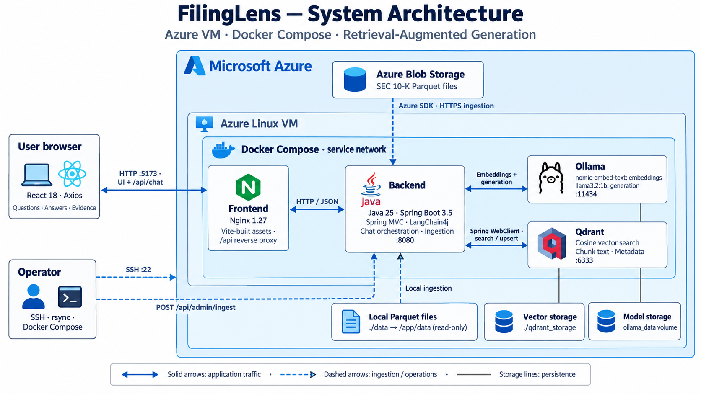
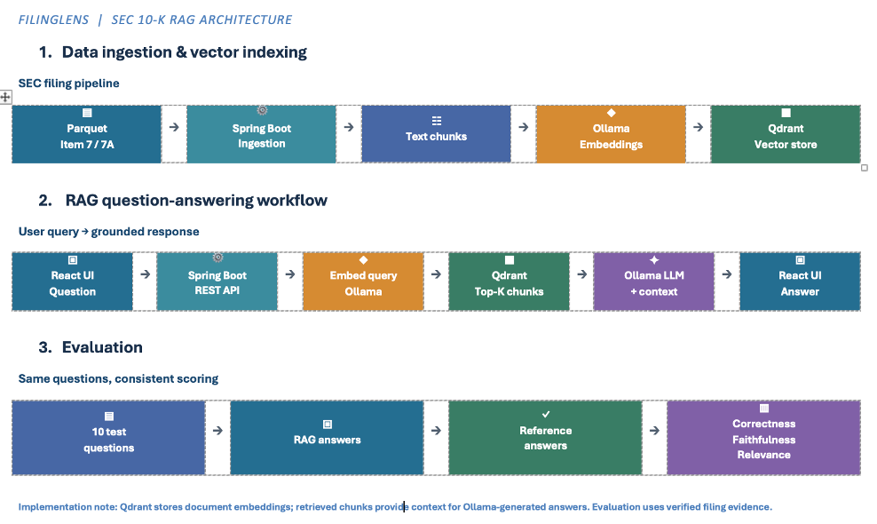

# FilingLens

Run the FilingLens UI locally and ask questions about SEC 10-K filings from:

- Section 7: Management's Discussion and Analysis
- Section 7A: Quantitative and Qualitative Disclosures About Market Risk

## System Architecture



FilingLens runs on an Azure Linux VM under Docker Compose:

- **Frontend** — React 18 + Axios, served by Nginx (port 5173), proxying `/api` to the backend.
- **Backend** — Java 25 / Spring Boot 3.5 with LangChain4j (port 8080). It orchestrates chat and ingestion, and talks to Ollama and Qdrant over the Compose service network.
- **Ollama** — local LLM serving: `nomic-embed-text` for embeddings and `llama3.2:1b` for generation (port 11434).
- **Qdrant** — vector store for chunk text and metadata, queried by cosine similarity (port 6333).
- **Ingestion** — SEC 10-K Parquet files (Sections 7 and 7A) are loaded from Azure Blob Storage or local `./data` files via `POST /api/admin/ingest`, embedded, and upserted into Qdrant.

Answers are grounded in the retrieved filing passages, and the UI shows the evidence alongside each answer.

## How It Works



**1. Data ingestion and vector indexing** — SEC 10-K Parquet files (Items 7 and 7A) are ingested by the Spring Boot backend, split into text chunks, embedded with Ollama, and stored in Qdrant.

**2. RAG question-answering** — A question from the React UI goes through the Spring Boot REST API, is embedded with Ollama, and retrieves the top-K matching chunks from Qdrant. The LLM then generates an answer using only that retrieved context, and the UI shows the answer with its source evidence.

**3. Evaluation** — A fixed set of 10 test questions is run through the RAG pipeline and scored against reference answers on correctness, faithfulness, and relevance, so results stay comparable across changes.

## Demo

<video src="https://raw.githubusercontent.com/rimasnh/sec-10k-rag-chatbot/main/docs/demo.mp4" controls width="100%"></video>

[Watch the demo video](https://github.com/rimasnh/sec-10k-rag-chatbot/blob/main/docs/demo.mp4)

Ask a question about a company's 10-K (Sections 7 and 7A) and watch FilingLens retrieve the relevant passages from Qdrant and answer with the source evidence shown alongside.

## What You Need

- Java 25 (latest LTS)
- Maven 3.9+
- Node.js 20+
- Docker and Docker Compose
- The parquet data file(s) in [`data/`](/project/FilingLens/data)
- A root [`.env`](./.env) file for compose interpolation. Copy [`.env.example`](./.env.example) first and then fill in any required values.

## Run Locally

1. Start Qdrant,Ollama,Frontend and Backend:

```bash
open /Applications/Docker.app
docker compose up -d --build
```

2. Pull the required Ollama models if they are not already available:

```bash
ollama pull llama3
ollama pull nomic-embed-text
```

3. Start the backend:

```bash
cd backend
mvn spring-boot:run
```

4. In a new terminal, load the filing data:

```bash
curl -X POST http://localhost:8080/api/admin/ingest
```

5. In a new terminal, start the frontend:

```bash
cd frontend
npm install
npm run dev
```

6. Open the UI:

```text
http://localhost:5173
```

## Deploy On A VM

1. Copy the project to the VM. A lean transfer from the project root looks like this:

```bash
rsync -avz -e "ssh -i ~/.ssh/azure_vm_key.pem" \
  --exclude '.env' \
  --exclude '.git' \
  --exclude '.DS_Store' \
  --exclude '.idea' \
  --exclude '.vscode' \
  --exclude 'backend/target' \
  --exclude 'backend/.m2' \
  --exclude 'backend/logs' \
  --exclude 'frontend/node_modules' \
  --exclude 'frontend/dist' \
  --exclude 'logs' \
  --exclude 'qdrant_storage' \
  --exclude 'output' \
  --exclude 'tmp' \
  ./ azureuser@YOUR_VM_IP:/home/azureuser/FilingLens/
```

2. SSH into the VM and go to the project directory:

```bash
ssh -i ~/.ssh/azure_vm_key.pem azureuser@YOUR_VM_IP
cd /home/azureuser/FilingLens
```

3. Set the VM IP so the backend allows the frontend origin:

```bash
export VM_IP=YOUR_VM_IP
```

4. Build and start the app:

```bash
sudo systemctl start docker
docker compose up -d --build
```

5. Pull the Ollama models:

```bash
docker compose exec ollama ollama pull llama3.2:1b
docker compose exec ollama ollama pull nomic-embed-text
```

6. Ingest the filing data:

```bash
curl -X POST http://localhost:8080/api/admin/ingest
```

7. Open Azure inbound rules for TCP ports `5173` and `8080`.

8. Open the app in your browser:

```text
http://YOUR_VM_IP:5173
```

## Use The UI

1. Enter a company name: `NortonLifeLock Inc.`
2. Select a filing year: `2022`
3. Ask a question about the filing.
4. Review the answer and expand the retrieved evidence to inspect the source text.

### Sample Questions

- `How many users does NortonLifeLock empower through its Cyber Safety platform?`
- `When did merger with Avast happen?`
- `What does this passage say about cyber safety platform reach?`
- `What changed year over year?`
- `What is mentioned in the Cooperation Agreement?`
- `Summarize the cooperative agreement with Avast.`

## If Something Does Not Work

- If the UI does not load, make sure the frontend is running on `http://localhost:5173`.
- If chat requests fail, make sure the backend is running on `http://localhost:8080`.
- If answers are empty, run the ingestion step again and confirm the parquet file exists in [`data/`](./data).
- If model calls fail, make sure Ollama is running and both models were pulled successfully.
- On a VM, if `http://YOUR_VM_IP:5173` does not open but the containers are running, check the Azure inbound rules and allow TCP port `5173`.
